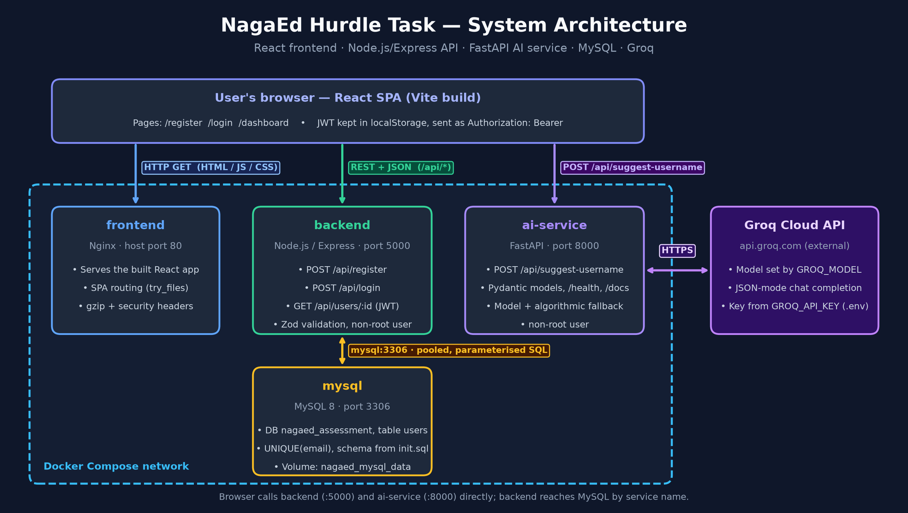

# NagaEd Hurdle Task — User Registration & Authentication with AI Username Suggestions

A small full-stack application: a React frontend, a Node.js (Express) REST API backed by MySQL, a FastAPI microservice that uses Groq to suggest usernames, and a Docker Compose setup that runs everything together.

## Author

- **Name:** `<your full name>`
- **Email:** `<your email>`
- **Phone:** `<your phone>`

## Architecture



| Service | Tech | Host port | Role |
| :--- | :--- | :--- | :--- |
| `frontend` | React (Vite), served by Nginx | 80 | Register, Login, Dashboard, username generator |
| `backend` | Node.js, Express 5 | 5000 | Auth API, JWT, MySQL access |
| `ai-service` | Python, FastAPI | 8000 | Calls Groq, returns 3 username suggestions |
| `mysql` | MySQL 8 | 3306 | Persistent user storage (named volume) |

How they communicate:

- The browser loads the React app from `frontend`, then calls `backend` (`/api/*`) and `ai-service` (`/api/suggest-username`) directly on their published host ports.
- `backend` reaches MySQL over the Compose network as `mysql:3306` (service name, not `localhost`).
- `ai-service` calls the Groq API over HTTPS using `GROQ_API_KEY`.
- The AI call is independent of auth: if `ai-service` or Groq is down, register, login and the dashboard still work.

## Run with Docker Compose

Prerequisites: Docker Desktop (Compose v2) and a free Groq API key from https://console.groq.com.

```cmd
copy .env.example .env
```

Edit `.env` and set at least `GROQ_API_KEY`, `JWT_SECRET` (32+ characters) and `DB_PASSWORD`. Then:

```cmd
docker compose up --build
```

| URL | What |
| :--- | :--- |
| http://localhost | React app |
| http://localhost:5000/api/health | Backend health |
| http://localhost:8000/docs | FastAPI Swagger UI |
| http://localhost:8000/health | AI service health |

The MySQL schema (`database/init.sql`) is applied automatically on the first start. The backend waits for the MySQL health check before starting. Data persists in the `nagaed_mysql_data` volume; `docker compose down -v` wipes it.

If a host port is already in use, change the left side of the mapping in `docker-compose.yml` (for example `"8001:8000"`) and update `VITE_AI_SERVICE_URL` in `.env` to match.

## Run locally without Docker

Requires Node 20+, Python 3.11+ and a running MySQL 8.

```cmd
:: 1. Database (creates DB + users table)
mysql -u root -p < backend\sql\schema.sql

:: 2. Backend
cd backend
copy .env.example .env
npm install
npm start

:: 3. AI service (new terminal)
cd ai-service
copy .env.example .env
python -m venv .venv
.venv\Scripts\pip install -r requirements.txt
.venv\Scripts\uvicorn app.main:app --port 8000

:: 4. Frontend (new terminal)
cd frontend
copy .env.example .env
npm install
npm run dev
```

Fill in the values in each `.env` (DB credentials, `JWT_SECRET`, `GROQ_API_KEY`). The app is then at http://localhost:5173.

## Environment variables

Root `.env.example` (used by Docker Compose):

| Variable | Purpose |
| :--- | :--- |
| `DB_USER`, `DB_PASSWORD`, `DB_NAME` | MySQL credentials / database name |
| `JWT_SECRET` | HS256 signing secret, 32+ characters |
| `JWT_EXPIRES_IN` | Token lifetime (default `1h`) |
| `GROQ_API_KEY` | Groq API key (never committed) |
| `GROQ_MODEL` | Preferred Groq model; the service falls back to other available models if it is unavailable on the account |
| `VITE_API_BASE_URL`, `VITE_AI_SERVICE_URL` | Browser-facing API URLs, baked in at frontend build time |

No secrets are committed; `.env` files are git-ignored.

## API

All Node endpoints return `{ "success": true, "message": "...", "data": {...} }` on success and `{ "success": false, "error": { "code": "...", "message": "...", "details": [] } }` on failure.

### `POST /api/register`

```json
{ "username": "noba", "email": "noba@example.com", "password": "StrongPassword123!", "address": "Kohima, Nagaland" }
```

`201` returns the created user (no password). `400 VALIDATION_ERROR` for missing/malformed fields (password 8–72 chars). `409 EMAIL_ALREADY_EXISTS` for a duplicate email (emails are lower-cased and trimmed). Passwords are hashed with bcrypt before insert.

### `POST /api/login`

```json
{ "email": "noba@example.com", "password": "StrongPassword123!" }
```

`200` returns `data.token` (JWT) and `data.user`. `401 INVALID_CREDENTIALS` for a wrong password or unknown email (same response for both).

### `GET /api/users/:id`

Header: `Authorization: Bearer <token>`. `200` returns the user without the password hash. `401` for missing, invalid or expired token. `403 FORBIDDEN` when requesting another user's record (users can only read their own). `404 USER_NOT_FOUND`. `400` for a non-numeric id.

### `POST /api/suggest-username` (FastAPI, port 8000)

```json
{ "interests": ["coding", "music", "gaming"] }
```

`200` returns `{ "suggestions": ["name1", "name2", "name3"] }`. `400 VALIDATION_ERROR` for an empty list or blank strings. `429` on Groq rate limiting, `503` if `GROQ_API_KEY` is not configured, `504` on upstream timeout. Interactive docs at `/docs`.

## Tests

Backend (Node test runner + Supertest). Tests that hit the database need MySQL reachable with the credentials in `backend/.env`; without it they are skipped and the validation/auth tests still run:

```cmd
cd backend
npm test
```

AI service (pytest, Groq is mocked so no API key or network is needed):

```cmd
cd ai-service
.venv\Scripts\python -m pytest -v
```

## Design notes

- **Layering (backend):** routes → controllers → services → repositories, with Zod schemas for input validation and centralised error middleware.
- **SQL safety:** all queries are parameterised (`pool.execute` with `?`).
- **Auth:** JWT (HS256, explicit expiry) verified by middleware; ownership check on `GET /api/users/:id`. Login compares against a dummy hash when the email does not exist, to avoid a timing-based user enumeration.
- **Config:** the backend validates environment variables at startup and exits if they are missing or invalid.
- **Containers:** multi-stage builds, `.dockerignore` in each service, non-root users in the backend and AI images, health checks in Compose.
- **Prompt (AI service):** the model is told to return exactly three alphanumeric, PascalCase usernames as JSON; output is parsed, sanitised, de-duplicated and topped up with a deterministic fallback if the model returns fewer than three valid names.

## Known limitations

- The JWT is kept in `localStorage` for simplicity. An httpOnly cookie would be safer against XSS but needs additional CORS/CSRF handling.
- No refresh tokens, email verification or password reset.
- No rate limiting on `/api/login` or `/api/register`.
- The AI endpoint is unauthenticated; the dashboard only exposes it to signed-in users.
